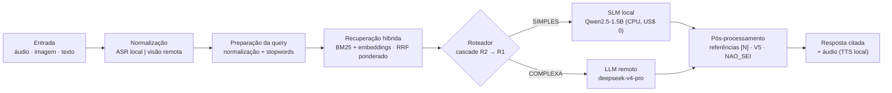

# Assistente Generativo Multimodal com RAG para Materiais Didáticos do Master IAG & LLM

#### Aluno: [Rafael Garcia](https://github.com/rafaelang)
#### Orientador: Leonardo Forero Mendoza
#### Curso: Master IAG & LLM (PUC-Rio)

---

Trabalho apresentado ao curso [Master IAG & LLM](https://ica.ele.puc-rio.br/cursos/ia-generativa-large-language-models/) como pré-requisito para conclusão de curso e obtenção de crédito na disciplina "Projetos de Sistemas Inteligentes de Apoio à Decisão".

- [Link para o código](https://github.com/rafaelang/proj-master--iag-llm-2025-2-puc-rio-final)
- **Projeto (demo):** [https://rafaelang-assistente-master-iag.hf.space/](https://rafaelang-assistente-master-iag.hf.space/)
- [Documentação técnica detalhada](README_DETALHADO.md)

---

### Resumo

Este trabalho constrói, de forma incremental e com evidência medida em cada etapa, um assistente generativo **multimodal** sobre os materiais didáticos do Master IAG & LLM (PUC-Rio). A pergunta pode entrar por **voz, imagem ou texto**, é processada por um fluxo **multiagente com RAG** e resulta em uma resposta que **cita a fonte** do material — ou em uma **abstenção explícita** (`NAO_SEI`) quando a pergunta está fora do corpus. O sistema combina etapas locais, executadas em CPU (ASR, TTS, OCR, BM25, embeddings e um SLM), com um LLM remoto (DeepSeek) para a geração de respostas complexas, publicadas em um Space público no Hugging Face.

Metodologicamente, o projeto seguiu o roadmap da disciplina em releases sucessivas (v0.1 a v1.0), cada uma acompanhada de **golden sets congelados**, métricas objetivas (WER, recall@k, MRR, acurácia, taxa de abstenção, fidelidade de citação, calibração e custo por consulta) e uma **decisão técnica registrada**. Entre as decisões centrais estão a ingestão anti-garbage, o chunking com overlay, a recuperação híbrida BM25 + embeddings com RRF ponderado, o OCR local de figuras, o roteamento `cascade` entre SLM local e LLM remoto, a regra determinística V5 para perguntas negativas e a decisão de **não treinar** modelos próprios.

Os resultados medidos mostram WER de **0,2290 → 0,0863** na voz; recall@5 de **1,000** no golden original e **0,828** no golden expandido de 516 perguntas; acurácia fim-a-fim de **0,609** no fluxo de produção (`cascade`) contra **0,832** do frontier pago em todas as perguntas, a um custo **~7,6× menor**; e custo de **US$ 0,79 por mil consultas** no fluxo publicado (US$ 0,29/mil no modo local com SLM na rota simples). O assistente está disponível em um Space público, com o corpus mantido em dataset privado.

### Abstract

This work builds, incrementally and with measured evidence at every stage, a **multimodal generative assistant** over the course materials of the Master IAG & LLM program (PUC-Rio). Questions may arrive as **speech, image or text**, are processed by a **multi-agent RAG pipeline**, and produce an answer that **cites its source** — or an explicit **abstention** (`NAO_SEI`) when the question falls outside the corpus. The system combines local CPU stages (ASR, TTS, OCR, BM25, embeddings and a small language model) with a remote LLM (DeepSeek) for complex generation, deployed to a public Hugging Face Space.

Methodologically, the project followed the course roadmap in successive releases (v0.1 to v1.0), each closing with **frozen golden sets**, objective metrics (WER, recall@k, MRR, accuracy, abstention rate, citation faithfulness, calibration and cost per query) and a **recorded technical decision**. Key decisions include anti-garbage ingestion, paragraph chunking with overlay, hybrid BM25 + embedding retrieval with weighted RRF, local OCR of figures, a `cascade` router between a local SLM and a remote LLM, the deterministic V5 rule for negative questions, and the decision **not to fine-tune** any model.

Measured results show WER dropping from **0.2290 to 0.0863** for speech; recall@5 of **1.000** on the original golden set and **0.828** on the expanded 516-question set; end-to-end accuracy of **0.609** for the production `cascade` versus **0.832** for a frontier model answering every question at **~7.6× the cost**; and **US$ 0.79 per thousand queries** in the deployed flow (US$ 0.29 per thousand in local mode with the SLM on the simple route). The assistant is publicly available, with the corpus kept in a private dataset.

### 1. Introdução

Os materiais do curso estão distribuídos em dezenas de PDFs, slides, notebooks e gravações. Encontrar uma resposta pontual — um conceito, uma fórmula, um trecho de código ou o significado de uma sigla — exige busca manual em fontes heterogêneas, muitas vezes sem saber em qual aula o assunto foi tratado. Assistentes baseados em LLMs poderiam intermediar essa consulta, mas modelos genéricos **alucinam** e não distinguem o que pertence ao curso do que não pertence, o que é inaceitável em um contexto didático.

O problema central deste trabalho é, portanto: **como responder perguntas sobre um corpus fechado, citando a fonte e abstendo-se quando a resposta não está no material?** A proposta é um assistente generativo com RAG (Retrieval-Augmented Generation) que aceita voz, imagem e texto, recupera trechos do corpus e gera a resposta com referência explícita; quando a evidência é insuficiente ou a pergunta é de outro domínio, o sistema responde `NAO_SEI`.

**Objetivos.**

- Construir um pipeline generativo ponta a ponta: voz → texto → recuperação → resposta citada → áudio.
- Medir cada etapa com métricas objetivas e golden sets reprodutíveis, registrando a evidência em Markdown.
- Comparar arquiteturas heterogêneas: SLM local × LLM remoto, com e sem RAG, prompt × fine-tuning.
- Publicar uma versão de produção com URL funcional e custo estimado por mil consultas.

**Contribuições.**

- Um fluxo multimodal unificado (`POST /chat` para áudio, imagem ou texto) com abstenção e citação.
- Ingestão anti-garbage, chunking com overlay e recuperação híbrida BM25 pt-BR + embeddings com RRF ponderado.
- OCR local de figuras do corpus, integrado ao índice textual.
- Roteamento `cascade` (classificador TF-IDF + XGBoost → SLM few-shot) e fallback cruzado entre rotas.
- Uma régua de avaliação estratificada e congelada, incluindo perguntas negativas e adversariais, além de auditoria do juiz automático.
- Evidência de que **engenharia de recuperação e pós-processamento** supera fine-tuning nesta tarefa.

**Domínio e corpus.** Materiais didáticos do Master IAG & LLM (PUC-Rio): ementas, PDFs de aulas, slides e notebooks. O corpus passou de 10 documentos na fundação para **193 documentos / 3.517 chunks** (PDF, Markdown, IPYNB e PPTX), mantido fora do Git por direitos autorais e LGPD; os golden sets, por outro lado, são versionados para garantir reprodutibilidade.

### 2. Modelagem

#### 2.1 Arquitetura geral

O sistema é organizado em um pipeline offline de ingestão e um pipeline online de recuperação, roteamento e geração. A figura abaixo resume o fluxo de produção.



- **Ingestão (offline):** extração e limpeza de páginas (anti-garbage), chunking por parágrafos (300–1.200 caracteres) com overlay de 100 caracteres, filtro de micro-chunks, índice BM25 próprio para pt-BR e embeddings multilíngues (fastembed/ONNX, 384 dimensões).
- **Recuperação (online):** top-30 BM25 + top-30 denso, fundidos por Reciprocal Rank Fusion (k=60; BM25 1,0 × denso 1,5), resultando no top-5 enviado ao gerador. O rerank cross-encoder foi testado e **desativado** por piorar o MRR.
- **Multimodalidade:** áudio é transcrito localmente (faster-whisper small com vocabulário de domínio) e respondido com áudio (Piper); imagens passam por um modelo de visão que extrai assunto e termos e alimentam a mesma consulta RAG.
- **Agentes:** a rota SIMPLES usa o SLM local (Qwen2.5-1.5B-Instruct GGUF, 100% CPU, custo zero) e a COMPLEXA usa o LLM remoto. Há fallback cruzado: falha ou resposta vazia em uma rota aciona a outra; se ambas falharem, o sistema abstém-se com motivo.
- **Figuras:** OCR local (RapidOCR/ONNX) sobre figuras extraídas dos PDFs (deduplicadas por sha1: 921 → 275 únicas; 22 úteis após filtros), indexadas em um índice separado de 294 chunks com peso 1,15 no RRF.
- **Produção:** API FastAPI em container Docker, com o corpus sincronizado em runtime a partir de um dataset privado no Hugging Face; o SLM local fica restrito ao ambiente local/CLI, e o Space usa roteador `flash`, rota simples `flash` e rota complexa `pro`.

#### 2.2 Releases e decisões

| Release | Capacidade | Decisão central |
|---|---|---|
| v0.1 | Voz | ASR local com vocabulário de domínio + TTS local |
| v0.2 | RAG | Ingestão anti-garbage, BM25 pt-BR + embeddings, RRF ponderado; rerank desativado |
| v0.3 | Imagem | OCR local das figuras + índice texto+imagem com peso no RRF |
| v0.4 | Agentes | SLM local na rota simples, LLM remoto na complexa, roteador `cascade`, fallback cruzado |
| v0.5 / v0.5b | Adaptação | Comparativo prompt × RAG × LoRA × pré-treino → **não treinar**; corpus expandido para 193 documentos |
| v0.6 | Avaliação | Avaliação por estrato, regra determinística V5, régua documento × página |
| v0.7 | Apêndice | Golden expandido para 516 perguntas; cenários de roteador (Kev, Laya) refutados |
| v1.0 | Produção | Space público + dataset privado, custo por mil consultas |

#### 2.3 Datasets e protocolo de avaliação

Todos os conjuntos de avaliação são versionados em `data/golden_set/` e possuem critério de rótulo congelado. As métricas são calculadas por scripts em `scripts/avaliadores/`, e os resultados oficiais são registrados em Markdown em `docs/`.

| Conjunto | Tamanho | Uso |
|---|---|---|
| Voz | 10 áudios próprios | WER com e sem vocabulário de domínio |
| RAG original | 20 perguntas | recall@5, MRR, acurácia fim-a-fim, abstenção |
| RAG v0.5b | 44 perguntas | reavaliação no corpus expandido |
| RAG v0.6 | 132 perguntas | avaliação por estrato (rotineira, composta, negativa, adversarial) |
| RAG v0.7 | 516 perguntas | re-medição com intervalo de confiança menor |
| Imagem | 3 perguntas | conteúdo da figura no top-5 e correção pela visão |
| Adaptação | 29 e 42 Q&A curados | matriz base × destilado × sem/com RAG |
| Roteador | 34 itens (20 canônicos + 14 typos) | acurácia de roteamento e calibração (ECE) |

O juiz automático é um LLM (`deepseek-v4-pro`) com rubrica fixa; sua consistência foi auditada (concordância, viés de comprimento e sensibilidade à rubrica). As perguntas **negativas** exigem abstenção e as **adversariais** são deliberadamente fora do corpus. A separação por estratos evita que a média esconda falhas sistemáticas.

### 3. Resultados

#### 3.1 Voz (v0.1)

| Métrica | Sem vocabulário | Com vocabulário |
|---|---|---|
| WER médio | 0,2290 | **0,0863** |
| Acurácia média | 77,10% | **91,37%** |
| Custo | US$ 0,00 (ASR/TTS local) | US$ 0,00 |

O vocabulário de domínio como `initial_prompt` foi o que reduziu o WER; ASR e TTS rodam em CPU, sem custo por consulta.

#### 3.2 Recuperação e RAG (v0.2 e v0.7)

| Métrica | v0.2 (20Q, 272 chunks) | v0.7 (441Q com fonte) |
|---|---|---|
| Recall@5 | **1,000** (16/16) | **0,828** |
| MRR | **0,969** | 0,665 |

No golden original, a acurácia fim-a-fim foi **0,700** (14/20), com abstenção correta **0,800**, citação presente em **100%** das respostas não abstidas e **zero alucinações** segundo o juiz. No golden de 516 perguntas, a amostra maior mostra que o retrieval mantém o perfil (recall@5 0,828) e que o limitante passa a ser a granularidade da fonte: a **página** (0,605) rende menos que o **documento** (0,659).

#### 3.3 Imagem (v0.3)

| Métrica (3 perguntas) | Texto-only | Texto + imagem |
|---|---|---|
| Conteúdo da figura no top-5 | 0,000 (0/3) | **1,000** (3/3) |
| Casos em que a visão corrigiu o texto | — | **3/3** |

Com o OCR indexado, perguntas cuja resposta existia apenas na figura passaram a ser respondidas com fonte; sem as figuras, o sistema abstinha-se.

#### 3.4 Agentes (v0.4)

| Métrica (20 perguntas) | Valor |
|---|---|
| Abstenção correta (R1, SLM) | **0,950** (19/20) |
| Abstenção correta (`cascade`) | 0,850 |
| Rotas | 13 simples · 7 complexas |
| Fallbacks | 0 |
| Latência média | 64,96 s (SLM em CPU; complexas ~9–28 s) |

O prompt few-shot corrigiu o viés do roteador (de 19/20 COMPLEXA para 13/7), e o limite de tokens eliminou respostas vazias do modelo remoto. O estudo de roteadores manteve o `cascade` como default por custo e latência, apesar de o SLM puro ter acurácia ligeiramente maior.

#### 3.5 Adaptação (v0.5 / v0.5b)

| Experimento | Resultado |
|---|---|
| Destilado LoRA (v0.5) | acurácia 0,40 → **0,30** por super-cautela |
| SLM destilado × base (v0.5b) | **0,364 × 0,295** com RAG |
| RAG + frontier (v0.5b) | **0,705** de acurácia, citação 100% |
| Prompt-only (v0.5b) | 0,884 de acurácia, **0% de citação**, 3 alucinações |

O fine-tuning melhorou o SLM dentro da própria receita, mas continuou distante do frontier e **não reduziu alucinações**. A decisão registrada foi **não treinar**; RAG + frontier permaneceu como produção.

#### 3.6 Avaliação estratificada (v0.6 e v0.7)

| Estrato | v0.6 (132Q) | v0.7 (516Q) |
|---|---|---|
| Rotineira | 0,609 | 0,664 |
| Composta | 0,586 | 0,633 |
| Negativa | 0,125 | 0,091 |
| Adversarial | 0,833 | 0,853 |
| **Total** | **0,575** | **0,609** |

A **negativa** foi a falha encontrada pelo aluno: o `cascade` abstinha demais (0,125). A auditoria mostrou que o juiz não era leniente e que a causa era recall@5 = 0. A regra determinística **V5** (casamento literal, janela de 14 tokens e mapa pt→SQL), que não usa LLM, resgatou **11/14** casos do tipo A a custo zero. A projeção fim-a-fim com V5 era 0,661 no golden de 132 perguntas.

No golden de 516 perguntas, o **frontier** (modelo remoto em todas as perguntas) mediu **0,832** de acurácia, contra **0,609** do `cascade` — uma diferença de **+0,22** a **~7,6× o custo**. O roteamento real foi de **89% simples / 11% complexa**; a negativa na rota simples (0,091) segue como o elo mais fraco e a V5 como a melhoria de maior retorno.

#### 3.7 Produção e custo (v1.0)

O assistente está publicado em [**https://rafaelang-assistente-master-iag.hf.space/**](https://rafaelang-assistente-master-iag.hf.space/) (Space `rafaelang/assistente-master-iag`, Docker, `cpu-upgrade`, sleep de 1 h). O endpoint `/saude` reporta **3.517 chunks**; o smoke test respondeu HTTP 200 em **14,7 s** com citação. O corpus fica em dataset privado e é baixado no boot, sem expor PDFs do curso.

| Fluxo | Custo por consulta | Por mil consultas |
|---|---|---|
| Deployado (`flash` + `pro`, off-peak) | US$ 0,00079 | **US$ 0,79** |
| Deployado (peak) | US$ 0,00158 | US$ 1,58 |
| Local (`cascade` + SLM na simples) | US$ 0,00029 | **US$ 0,29** |
| Frontier em todas as perguntas (v0.7, preços da medição) | US$ 0,001086 | US$ 1,09 |
| `cascade` medido no golden v0.7 | US$ 0,000143 | US$ 0,14 |

O break-even para self-host do SLM fica entre **~60 mil e ~140 mil respostas/mês**, acima da demanda acadêmica real; por isso a API `flash`/`pro` é a escolha racional na operação atual.

### 4. Conclusões

1. **RAG + frontier é o que funciona.** A rota sem RAG alucina e não cita (0% de citação na v0.5); com RAG, as respostas citam a fonte e a abstenção é possível. Nenhum motor local testado bateu o frontier nesta tarefa.
2. **"Não treinar" é a conclusão mais sustentada do projeto.** Confirmada na v0.5, na v0.5b e nos cenários de roteador da v0.7 (Kev, Laya zero-shot e Laya fine-tuned). O fine-tune do Laya melhora dentro da própria receita (0,99/1,00), mas colapsa na régua congelada (0,676 × R2 0,941) e destrói a calibração (ECE 0,052 → 0,337).
3. **O que moveu a agulha foi engenharia, não treino:** ingestão anti-garbage, OCR de figuras, RRF ponderado, roteamento por custo e a regra V5.
4. **Cenários negativos são evidência, não fracasso.** Documentar que R2 (TF-IDF + XGBoost, ~85% do tráfego a menos de 2 ms e custo zero) e R1 superam todos os candidatos evitou uma troca por infraestrutura mais cara e pior.
5. **O limitante atual não é o modelo, é a granularidade da fonte** — a página rende **menos** que o documento — e os estratos frágeis (negativa e composta). É por aí que a próxima release deve evoluir.

Como limitações, a rota local em CPU tem latência alta para uso interativo, o estrato negativo ainda depende de uma regra específica de domínio e a avaliação usa um juiz automático, auditado mas não substituível por revisão humana integral. Trabalhos futuros incluem rerank por página, calibração da abstenção na rota simples e ampliação da auditoria humana do golden set.

### 5. Referências

1. PUC-Rio — Curso [Master IAG & LLM](https://ica.ele.puc-rio.br/cursos/ia-generativa-large-language-models/). Materiais didáticos do curso (corpus deste trabalho).
2. DeepSeek. [API Docs — Models & Pricing](https://api-docs.deepseek.com/quick_start/pricing). Acesso em out. 2026.
3. SYSTRAN. [faster-whisper](https://github.com/SYSTRAN/faster-whisper). ASR local em CPU.
4. Rhasspy. [Piper TTS](https://github.com/rhasspy/piper). Síntese de voz local em pt-BR.
5. RapidAI. [RapidOCR](https://github.com/RapidAI/RapidOCR). OCR local baseado em ONNX Runtime.
6. Qdrant. [fastembed](https://github.com/qdrant/fastembed). Embeddings locais em ONNX.
7. Abetlen. [llama-cpp-python](https://github.com/abetlen/llama-cpp-python). Inferência local de modelos GGUF em CPU.
8. Qwen Team. [Qwen2.5](https://github.com/QwenLM/Qwen2.5). Modelo de linguagem pequeno utilizado na rota simples.
9. Documentação interna: [`README_DETALHADO.md`](README_DETALHADO.md), [`docs/README.md`](docs/README.md) e [`docs/adr/`](docs/adr/).
10. Projeto em produção: [https://rafaelang-assistente-master-iag.hf.space/](https://rafaelang-assistente-master-iag.hf.space/).

### 6. Instalação

Requisitos: Python **3.14** (definido em `.python-version`), [`uv`](https://docs.astral.sh/uv/) e acesso à API DeepSeek.

```bash
git clone git@github.com:rafaelang/proj-master--iag-llm-2025-2-puc-rio-final.git
cd proj-master--iag-llm-2025-2-puc-rio-final

uv venv
source .venv/bin/activate
uv sync
```

Crie um `.env` na raiz (não versionado):

```bash
DEEPSEEK_API_KEY=sk-...
DEEPSEEK_BASE_URL=https://api.deepseek.com   # ou o gateway utilizado
DEEPSEEK_MODEL=deepseek-v4.1-flash
JUIZ_MODEL=deepseek-v4-pro
```

O corpus bruto (`data/raw/`) e os índices (`data/processed/`) **não estão no repositório** por direitos autorais/LGPD; no ambiente de desenvolvimento eles precisam ser preparados localmente. Modelos de ASR, TTS, embeddings e OCR são baixados automaticamente na primeira execução.

### 7. Como executar

**API (interface web e `/chat`):**

```bash
uvicorn src.projeto_final.main:app --host 0.0.0.0 --port 7860
# abra http://localhost:7860
```

O endpoint `POST /chat` aceita `file` (áudio ou imagem) ou `texto` e devolve JSON com `resposta`, `audio_base64`, `abstencao`, `referencias` e `latencia_s`.

**CLI multiagente:**

```bash
python -m projeto_final.agentes perguntar "o que é um VAE?"
python -m projeto_final.agentes avaliar --roteador cascade
```

**Avaliadores (evidência por release):**

```bash
python scripts/avaliadores/avaliar_v1.py   # WER da voz
python scripts/avaliadores/avaliar_v2.py   # RAG
python scripts/avaliadores/avaliar_v3.py   # imagem/OCR (--e2e para LLM)
python scripts/avaliadores/avaliar_v4.py   # agentes (--roteador/--simples/--complexa)
python scripts/avaliadores/avaliar_v07.py  # frontier RAG no golden 516Q
```

**Testes:**

```bash
pytest tests/
```

**Deploy:**

```bash
bash deploy/deploy.sh --dry-run   # revisa o bundle
bash deploy/deploy.sh             # publica no Space
```

---

Matrícula: 251.100.863

Pontifícia Universidade Católica do Rio de Janeiro

Curso de Pós Graduação *Master IAG & LLM - Inteligência Artificial Generativa & Large Language Models*
